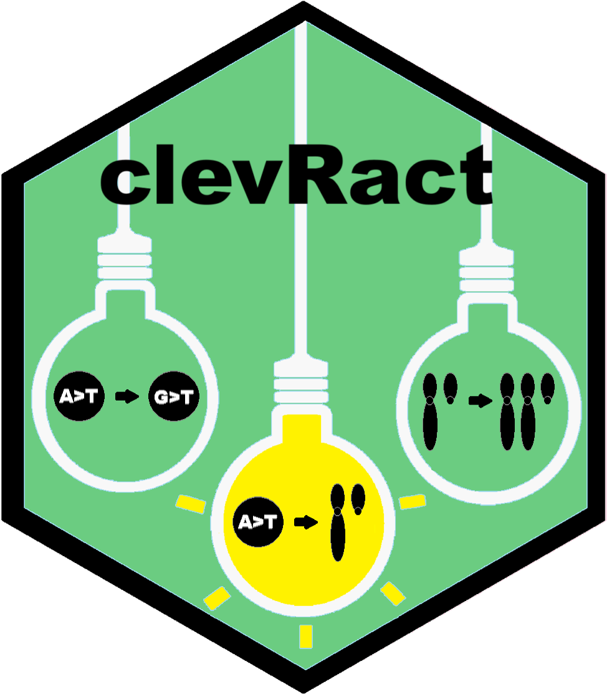

<p align="center">
  
</p>

<h1 align="center">clevRact</h1>

<p align="center">
  <strong>Explore shared patterns in cancer clonal evolution.</strong><br>
  An interactive Shiny application for conserved linear trajectorys and branching trajectories.
</p>

<p align="center">
  <a href="#installation">Installation</a> &middot;
  <a href="#quick-start">Quick start</a> &middot;
  <a href="vignettes/clevRact.Rmd">Tutorial</a> &middot;
  <a href="https://github.com/MalteNick/clevRact/issues">Report an issue</a>
</p>

---

**clevRact** (*clonal evolution in R analysing conserved trajectories*) helps
explore recurrent evolutionary patterns across cohorts of patient-specific
tumor trees. Starting from clone relationships and genomic variants, you can
inspect your cohort, identify shared orders of events, and approximate conserved
branching trajectories through a graphical interface.

A **trajectory** is a pattern of alteration events with a defined evolutionary
structure. A **linear trajectory** follows a single chain of events. A
**branching trajectory** contains a branch point, including at the variant-free
root. The app uses supplied clone relationships as its starting point.

## From patient trees to shared trajectories

| Step | What you can do |
|:-----|:----------------|
| **1. Input Data** | Import or edit a cohort and explore individual tumor trees with shark and dolphin plots powered by `clevRvis`. |
| **2. Processed Data** | Generate labels using GRCh37 or GRCh38, choose gene or exact-position SNV/INDEL labels, and represent CNVs at chromosome, arm, or interval resolution. |
| **3. Data Statistics** | Inspect cohort composition, clone counts, variant recurrence, and alteration types. |
| **4. Linear Trajectories** | Find recurrent event sequences, estimate enrichment, and optionally pool overlapping CNVs into shared regional linear trajectories. |
| **5. Trajectory Reconstruction** | Recombine linear trajectories into branching patterns, include independent branches through the root, estimate significance, and export results. |

Repeated events can retain shared labels, allowing exploration of both successive
and parallel occurrences of the same alteration. Support counts refer to distinct
patients, so multiple matches in one patient count once.

## Installation

Requires **R >= 4.6.0**, as specified in [DESCRIPTION](DESCRIPTION).
The package is being prepared for Bioconductor submission.

### Bioconductor

Once clevRact is available in Bioconductor, install it with:

```r
if (!requireNamespace("BiocManager", quietly = TRUE)) {
    install.packages("BiocManager")
}
BiocManager::install("clevRact")
```

### From a local source checkout

Before Bioconductor availability, open R in the package directory containing
`DESCRIPTION` and install the source package and its dependencies:

```r
if (!requireNamespace("BiocManager", quietly = TRUE)) {
    install.packages("BiocManager")
}
options(repos = BiocManager::repositories())
BiocManager::install("remotes")
remotes::install_local(".", dependencies = TRUE, build_vignettes = TRUE)
```

## Quick start

Launch the app from an interactive R session:

```r
library(clevRact)
shiny::runApp(clevRactApp())
```

`clevRactApp()` creates a Shiny application object; `shiny::runApp()` starts it.

### Try the ten-patient example

The package includes a synthetic cohort with repeated NOTCH1 events, downstream
FBXW7 events, branching histories, and overlapping CNVs. Its coordinates use
**GRCh37**.

Locate the file before launching the app, or from a separate R session:

```r
example_file <- system.file(
    "extdata", "synthetic_10_patients.csv", package = "clevRact"
)
example_file
```

1. Upload this file in **Input Data**.
2. In **Processed Data**, select **Yes, using GRCh37** for label generation,
   then click **Generate Processed Data**.
3. Inspect **Data Statistics**, compute linear trajectories, and explore trajectories.

The [worked tutorial](vignettes/clevRact.Rmd) provides exact settings and expected
results for repeated events, unresolved orders, independent branches, and CNV
region overlap. If the vignette is installed, open it directly in R:

```r
vignette("clevRact", package = "clevRact")
```

## Bring your own data

Use a **semicolon-separated CSV** with one row per variant occurrence in a clone.

| Column | Contents |
|:-------|:---------|
| `Patient.ID` | Patient identifier. |
| `Variant` | Variant label or identifier. |
| `Clone` | Positive integer identifying the clone within a patient. |
| `Parent` | Parent clone identifier; `0` denotes the normal-cell root. |
| `Variant.Type` | `CNV_del`, `CNV_dup`, `CNV_loh`, `SNV/INDEL`, or `NA`. |
| `Chromosome` | `1`–`22`, `X`, `Y`, or `NA`. |
| `Start`, `End` | Genomic coordinates, or `NA`. |
| `T1`, `T2`, … | Optional Boolean observations: `TRUE` if the clone is observed at that time point, otherwise `FALSE`. |

Each patient's `Clone` and `Parent` values must describe a valid rooted tree.
Rows belonging to the same clone share the same parent; the normal-cell root has
no variant row. Match the annotation assembly to your input coordinates when
generating labels automatically.

For a first analysis, start with short linear trajectories and a minimum patient support
greater than one. Inspect and filter the linear trajectories before increasing trajectory
recombination depth, since larger searches can become computationally expensive.

## Documentation and support

- **Tutorial:** [workflow, input format, and worked example](vignettes/clevRact.Rmd).
- **Function help:** `?clevRactApp` in R.
- **Bug reports and feature requests:** [GitHub issues](https://github.com/MalteNick/clevRact/issues).
- **Citation:** `citation("clevRact")` in R.

When reporting an issue, include a minimal reproducible example and the output of
`sessionInfo()`.

## Authors and maintainers

Malte Nick (author and maintainer) and Sarah Sandmann (author).

*AI disclosure: This documentation was generated with the assistance of AI
coding agents.*
